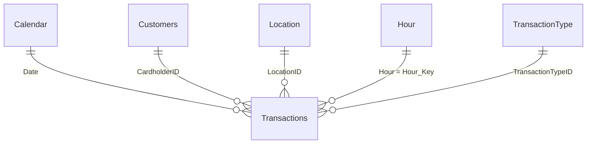

# ATM Transaction Analysis – Power BI

A Power BI dashboard and data model for analysing ATM transaction activity: volumes, amounts, customer behaviour, location performance and ATM utilization.

> **Data period:** 1 Jan 2022 – 31 Dec 2022 · **~2.14 million** transactions · **131** ATMs

## Data Model

The model is a **star schema** with `Transactions` as the central fact table. All relationships are many-to-one with single-direction filtering.



| From (many) | To (one) | Key |
|---|---|---|
| Transactions | Calendar | `Date` |
| Transactions | Customers | `CardholderID` |
| Transactions | Location | `LocationID` |
| Transactions | Hour | `Hour` → `Hour_Key` |
| Transactions | Transaction Type | `TransactionTypeID` |

## Tables

| Table | Type | Description |
|---|---|---|
| **Transactions** | Fact | One row per ATM transaction: `TransactionID`, `Date`, `Duration`, `Hour`, `CardholderID`, `LocationID`, `TransactionTypeID`, `TransactionAmount` |
| **Calendar** | Dimension | Date attributes: Year, Month, Month Name, Quarter, Week of Year, End of Week, Day of Week, Day Name, IsHoliday |
| **Customers** | Dimension | Cardholder attributes: Gender, Occupation, AccountType, IsWisabi, Age, Age Group, ATMID |
| **Location** | Dimension | ATM site details: Location Name, No of ATMs, City, State, Country |
| **Hour** | Dimension | Hour-of-day lookup: Hour_Key, Hour_Start_Time, Hour_End_Time |
| **Transaction Type** | Dimension | Transaction type lookup: TransactionTypeID, TransactionTypeName |
| **_MeasureTable** | Helper | Holds all DAX measures |

## Measures

| Measure | DAX | Format |
|---|---|---|
| **Transaction_Count** | `COUNTROWS(Transactions)` | `0` |
| **TransactionAmount** | `SUM(Transactions[TransactionAmount])` | `0` |
| **AverageAmount** | `AVERAGE(Transactions[TransactionAmount])` | General |
| **No_Of_Customer** | `DISTINCTCOUNT(Transactions[CardholderID])` | `0` |
| **Transaction_frequncy** | `DIVIDE([Transaction_Count], [No_Of_Customer])` | General |
| **AverageDuration** | `AVERAGE(Transactions[Duration])` | General |
| **% Transaction** | `DIVIDE([Transaction_Count], CALCULATE([Transaction_Count], ALLSELECTED(Transactions)))` | `0.00%` |
| **Utilization Rate** | See below | `0.00%` |

## Utilization Rate Explained

Utilization Rate measures how much of the available ATM time was spent serving transactions.

```dax
Utilization Rate =
VAR transaction_time = SUM(Transactions[Duration])
VAR days_in_period   = COUNTROWS('Calendar')
VAR available_time   = 24 * 60 * days_in_period * SUM(Location[No of ATMs])
RETURN
    DIVIDE(transaction_time, available_time)
```

- **Numerator:** total transaction duration in the selected period.
- **Denominator:** minutes in the period (`24 × 60 × days`) multiplied by the number of ATMs.
- Because the day count comes from `Calendar`, the measure responds correctly to year, quarter, month and date slicers. Overall utilization for 2022 is about **12.9%**.


## Tools

- Power BI Desktop
- DAX
- Power Querry
